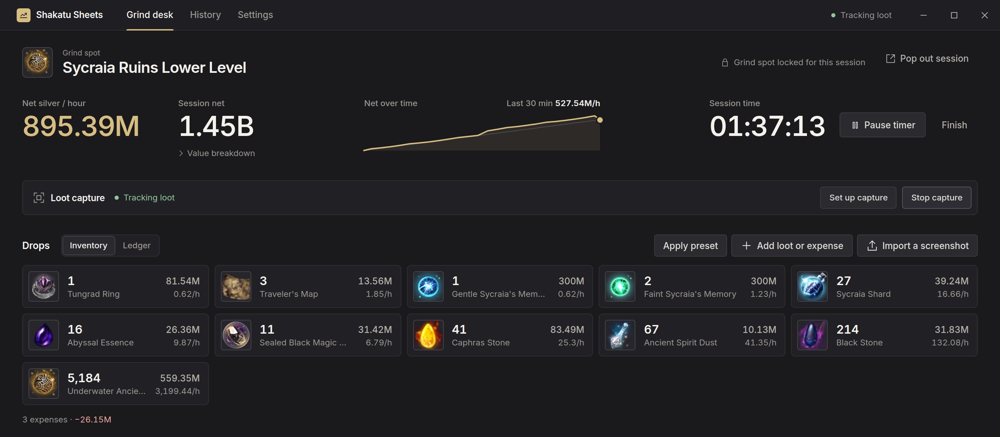
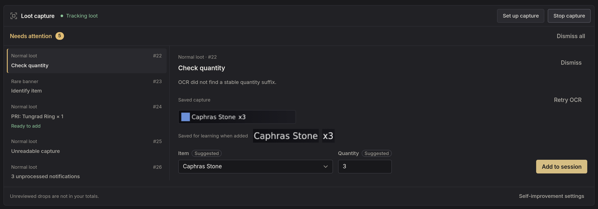
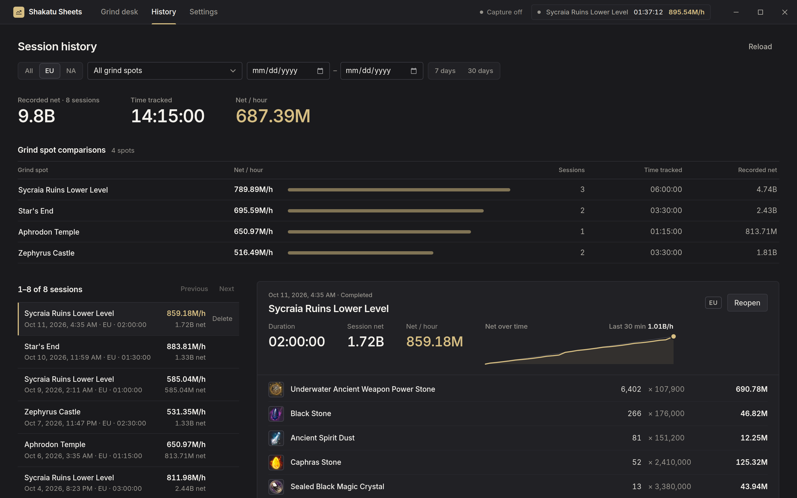
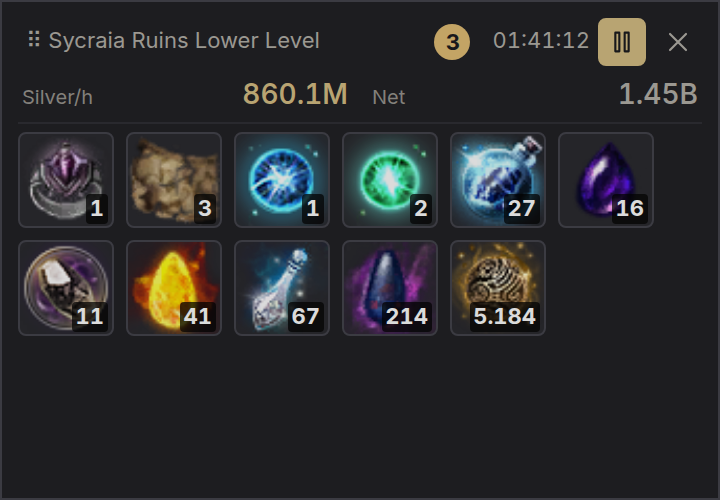

# Shakatu Sheets

A local-first silver-per-hour tracker for Black Desert Online, for Windows and Linux.

Shakatu Sheets times your grind sessions, values your loot at Central Market prices, and can read drops off your screen
as they happen. Everything is stored on your computer. Nothing leaves it unless you press a button that says so.



[](https://ko-fi.com/V3Z427UAJQ)

## Contents

- [Features](#features)
- [Screenshots](#screenshots)
- [Platform support](#platform-support)
- [Live loot recognition](#live-loot-recognition)
- [Privacy and data](#privacy-and-data)
- [Fair play](#fair-play)
- [Installation](#installation)
- [Garmoth integration](#garmoth-integration)
- [Known limitations](#known-limitations)
- [Contributing](#contributing)
- [Support the project](#support-the-project)
- [Acknowledgements](#acknowledgements)
- [License](#license)

## Features

**Session tracking**

- Live timer with pause and resume, or manually entered hours.
- Net silver per hour after market tax and expenses, with a net-over-time trend for the running session.
- Loot ledger with editable quantities and prices, shown as item tiles or as a table.
- Expenses and reusable consumable presets per region.
- A compact always-on-top session overlay you can keep over the game.

**Prices**

- EU and NA Central Market price snapshots from [Arsha](https://api.arsha.io), fetched only when you ask.
- Each entry keeps the price it was recorded with, so finished sessions never change when the market moves.

**Loot recognition**

- Live recognition of normal and rare loot notifications through screen capture and local OCR.
- Uncertain drops wait in a **Needs attention** queue for you to confirm or correct, instead of being guessed.
- Import of cropped Marni loot tracker screenshots (80%, 100%, or 120% UI scale) with an editable review step.

**Self-improvement**

The reader can learn from the drops you correct, so it gets better at your setup over time. It is off by default; turn
on **Learn from my corrections** in **Settings → Self-improvement**.

- Each correction you confirm in **Needs attention** teaches item names and quantities separately, so learning
  Black Stone ×6 also helps with Black Stone ×9.
- Learned suggestions prefill the correction form and are marked **Suggested**. Nothing is added until you confirm it.
- The optional **Auto allow** setting resolves drops that ordinary OCR could not, but only when learned examples agree
  across at least three frames and nothing conflicts.
- Examples are small text crops stored on your device. You can inspect or delete them one by one, or reset everything.



**History**

- Completed sessions filtered by region, date range, and grind spot.
- Totals, duration-weighted silver per hour, and a per-spot comparison of your own rates.
- A spot browser covering 90+ grind spots, including Dehkia variants, with your recorded rate for each.

**Integrations and appearance**

- Optional uploads of completed sessions to your [Garmoth](https://garmoth.com) grind tracker.
- Dark and light themes, keyboard navigation, and screen-reader labels.

## Screenshots

**History.** Totals, grind spot comparisons, and a receipt for each completed session.



**Session overlay.** A compact, always-on-top view of the running session to keep over the game.



## Platform support

| Platform | Status |
| --- | --- |
| Windows 11 (x64) | Supported and tested by users. |
| Windows 10 1809+ (x64) | Expected to work, not yet tested. |
| Linux, Wayland (KDE Plasma, Hyprland, Sway) | Supported. Main development platform. |
| Linux, GNOME or X11 | Runs, but the overlay is an ordinary window that may not stay above a fullscreen game. |
| macOS | Not supported. |

Screen capture on Linux uses the desktop's screen-sharing portal, so you need an `xdg-desktop-portal` backend with
screen-cast support (KDE, GNOME, Hyprland, and wlroots desktops ship one). The overlay stays above fullscreen games on
compositors that support the layer-shell protocol.

On Windows, play BDO in borderless mode and pick either your monitor or the BDO window in the capture picker. Exclusive
fullscreen and HDR are not supported.

## Live loot recognition

Live recognition reads the loot notifications at the side of your screen. It currently needs:

| Setting | Supported values |
| --- | --- |
| Game language | English |
| Resolution | 1920×1080, 2560×1440, or 3440×1440 |
| BDO UI scale | 80% or 100% |
| Loot font | Korean (default) or Strong Sword |

1920×1080 uses the same recognition settings as 1440p, because BDO draws loot notifications at the same pixel size for
a given UI scale. It is supported but not yet verified on real gameplay, so please report drops it misses or misreads.

How it works:

1. Start capture and choose your monitor (or the game window on Windows) in the system picker.
2. Position the normal and rare loot areas in setup, or use **Adjust automatically**, then confirm them. You can also
   import the normal loot position from your game's `gamevariable.xml`.
3. Grind. Drops are added to the ledger as they appear. Anything uncertain goes to **Needs attention**.

Recognition only looks for items that can drop at the selected grind spot. It reads several frames per drop and adds
nothing unless they agree. When it can't be sure, it asks you. Rare-drop detection is still being tuned.

## Privacy and data

- **Local storage.** Sessions, settings, and price snapshots are kept in SQLite databases in your app data folder:
  - Linux: `~/.local/share/io.github.shakatusheets/`
  - Windows: `%APPDATA%\io.github.shakatusheets\`
- **Screen capture.** Frames are processed in memory and never written to disk. Captures waiting for review are
  discarded once handled, when the session finishes, or when the app closes.
- **Self-improvement.** When you turn it on, it saves small text crops from corrected drops (never full screenshots)
  in a separate `quantity-learning.sqlite3`. You can inspect, delete, or reset these in Settings.
- **Network.** The app contacts only two services, and only when you press a button: Arsha to fetch market prices, and
  Garmoth to validate your key, fetch your characters, or upload a session. There is no telemetry, analytics, or update
  check.
- **Garmoth API key.** Stored unencrypted in the local settings database. On Linux the data folder is readable only by
  your user.

## Fair play

Shakatu Sheets only looks at your screen, through the same system screen-sharing picker a streaming app uses. It does
not read or modify game memory, inject into the game process, send input to the game, or automate gameplay. The only
game file it ever reads is a `gamevariable.xml` you select yourself, to find your loot window position.

## Installation

Pre-built downloads will be published on the [Releases](https://github.com/TobiasLab/shakatu-sheets/releases) page.
Until then, build from source.

### Prerequisites

- [Node.js](https://nodejs.org) 22.23.2 (see `.node-version`)
- [Rust](https://rustup.rs) 1.98.0 (installed automatically from `rust-toolchain.toml`)
- The [Tauri prerequisites](https://v2.tauri.app/start/prerequisites/) for your platform

**Linux** also needs GTK Layer Shell 0.6 or later, the PipeWire development headers, and Clang:

```sh
# Debian / Ubuntu
sudo apt install libgtk-layer-shell-dev libpipewire-0.3-dev clang
# Fedora
sudo dnf install gtk-layer-shell-devel pipewire-devel clang
# Arch
sudo pacman -S gtk-layer-shell pipewire clang
```

**Windows** needs Visual Studio 2022 Build Tools with *Desktop development with C++*, CMake, NASM, and WebView2. See
[Windows support](documentation/development/windows.md#native-development) for details.

### Run from source

```sh
git clone https://github.com/TobiasLab/shakatu-sheets.git
cd shakatu-sheets
npm ci
npm run tauri dev
```

### Build packages

```sh
# Linux: deb, rpm, and AppImage under src-tauri/target/release/bundle/
npm run bundle:linux

# Windows: per-user NSIS installer under src-tauri/target/release/bundle/nsis/
npm run bundle:windows
```

`bundle:linux` disables binary stripping because linuxdeploy's bundled tools cannot read the RELR sections produced on
Arch-based systems. The AppImage forces X11, which disables the layer-shell overlay, so prefer the deb or rpm package on
Wayland. Windows builds are not code-signed yet, so SmartScreen may warn on first launch.

## Garmoth integration

Uploading is optional. To use it:

1. Open **Settings → Garmoth** and save your personal Garmoth API key. Each user needs their own key, and the app
   checks it with Garmoth before saving.
2. Enter the ID from the end of each of your Garmoth character URLs, fetch them, and select your upload character.
3. In **History**, select a finished session and choose **Upload to Garmoth**. You review the payload, consumables, and drop buffs before
   anything is sent.

Shakatu Sheets never uploads automatically. Sharing to Garmoth's global data is off by default.

## Known limitations

- Live recognition supports only the resolutions, UI scales, and English client listed above.
- Only EU and NA market prices are available.
- Market prices come from an unofficial source and can occasionally be unavailable. A failed fetch keeps your existing
  prices.
- There is no automatic updater. Install new versions manually.
- Sessions are kept per device. There is no sync or cloud backup; back up the data folder if you need to.

## Contributing

Bug reports and pull requests are welcome. When reporting a recognition problem, include your OS, desktop or Windows
version, resolution, BDO UI scale, and loot font.

The [documentation](documentation/README.md) covers architecture, the database schema, product behavior, and the
[development setup and branch workflow](documentation/development/README.md). Before opening a pull request, run:

```sh
npm run check
npm test
npm run build
cd src-tauri
cargo fmt --check
cargo test
cargo clippy --all-targets --all-features -- -D warnings
```

## Support the project

Shakatu Sheets is free and always will be. If it saves you some spreadsheet time, you can support development on
Ko-fi:

[](https://ko-fi.com/V3Z427UAJQ)

## Acknowledgements

- [Garmoth](https://garmoth.com), for permission to use its grind-spot data and API. This project would not be possible without Skou. Check out the official Garmoth app if you want a more refined Windows-experience.
- [Arsha](https://api.arsha.io), for the Central Market price API.
- [Tesseract.js](https://github.com/naptha/tesseract.js), for local OCR.
- [Tauri](https://tauri.app), for the application framework.

## License

Copyright (C) 2026 Shakatu Sheets contributors.

Shakatu Sheets is licensed under the GNU Affero General Public License, version 3 only (`AGPL-3.0-only`). The full
license text is in [`LICENSE`](LICENSE). This program is distributed WITHOUT ANY WARRANTY; see the license for details.

Black Desert and all related game content, names, and item artwork are trademarks or copyrighted material of Pearl
Abyss Corp. and are not covered by this license. Shakatu Sheets is a fan-made tool and is not affiliated with or endorsed
by Pearl Abyss or Garmoth.
